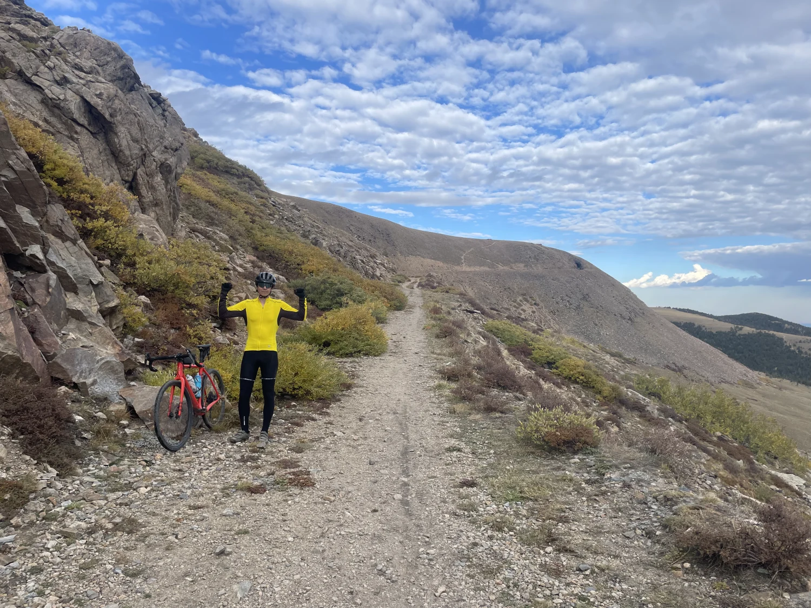
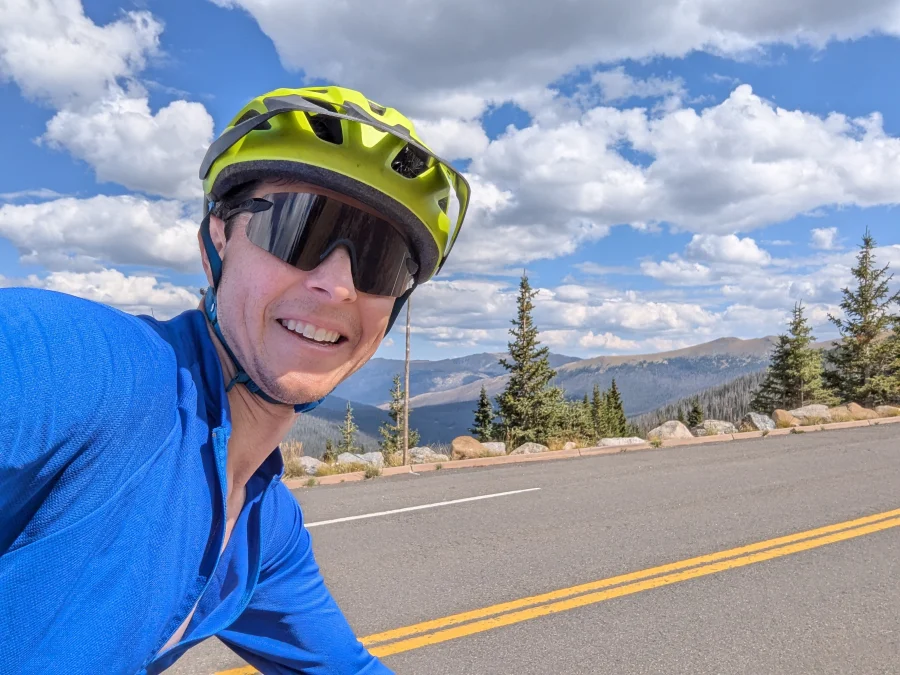
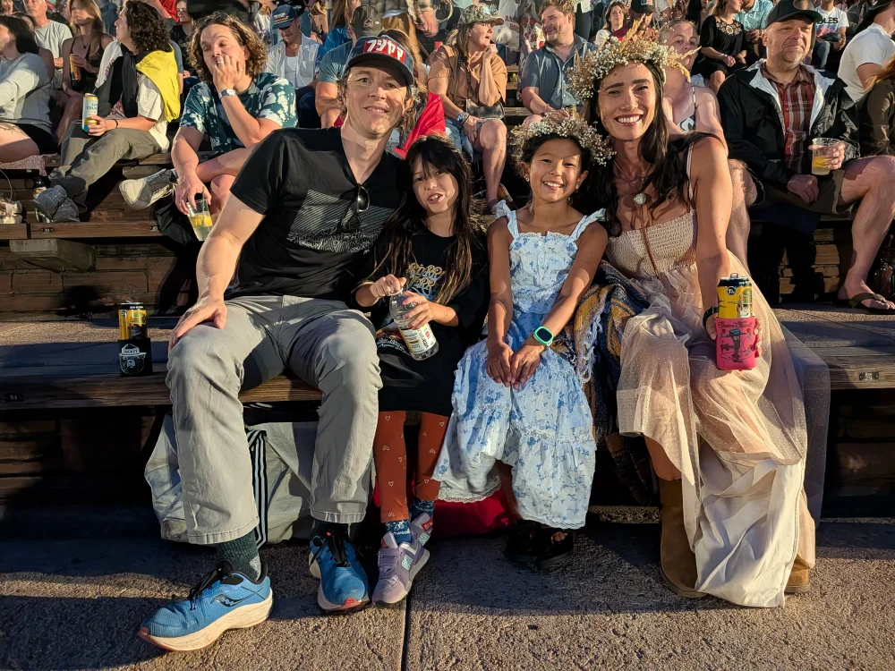
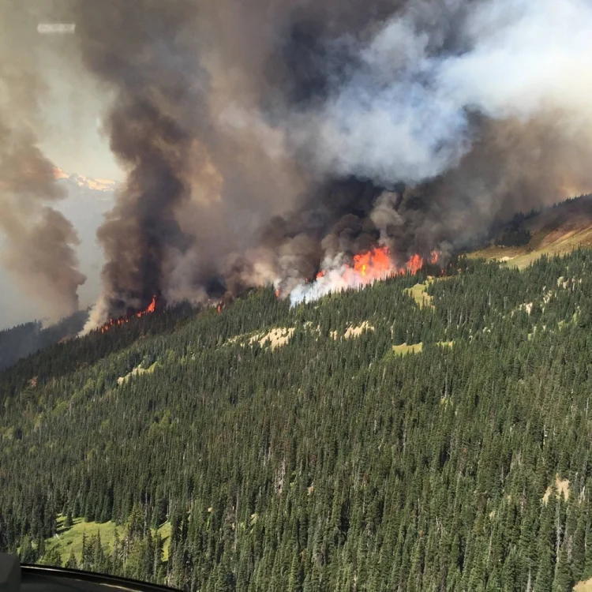
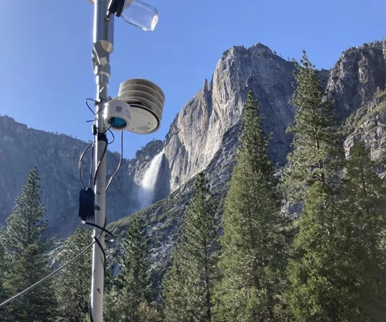
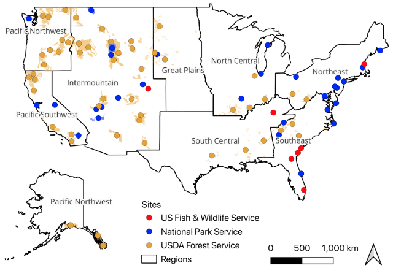

## A little about me {.about-me}

**Jude Bayham · Colorado State University**

```{=html}
<div class="photo-collage">
  
  
  
  <div class="family-portrait">
    
  </div>
</div>
```

## My path to Colorado State

{.career-map fig-alt="A dotted route runs from Chico, California (Chico State), through Moscow, Idaho (University of Idaho), and Pullman, Washington (Washington State University), to New Haven, Connecticut (Yale University). It returns to Chico before continuing to Fort Collins, Colorado (Colorado State University). The Pullman and Moscow logos sit on opposite sides of the route."}


## What I teach and research at CSU

**Teaching:** Data driven decision making, economics of outdoor recreation, graduate optimization for economists

**Research**

```{=html}
<div class="research-panels">
  <figure>
    
    <figcaption>Wildfire management</figcaption>
  </figure>
  <figure>
    
    <figcaption>Air quality</figcaption>
  </figure>
  <figure>
    
    <figcaption>Estimating visits with mobile data</figcaption>
  </figure>
</div>
```


## What this course asks

**Why do firms and people choose particular places?**

Why do some regions grow faster than others?

How can we evaluate a new factory, road, or regional policy?

::: {.takeaway}
No advance reading is expected today. We will build the ideas together.
:::


## Motivating example: a new factory
::: {.columns}
::: {.column width="48%"}
A firm plans to open a factory. It needs materials, workers, space, and customers.

::: {.prompt}
Where should it locate?

What impact will it have on the surrounding area?
:::

Discuss with a neighbor, then explain why each matters.

I don't expect you to use the proper/formal economic terms.

:::
::: {.column width="52%"}
{.generated-illustration width="100%" fig-alt="Illustrative factory location choice: dotted routes connect a proposed factory to raw materials, a container port, and a city with workers and customers. No preferred site is indicated."}
:::
:::


## Course progression

**Location and growth:** why activity concentrates and regions change.

**Regional measurement:** use data to describe places and industries.

**Land, housing, and amenities:** connect location choices to wages and prices.

**Regional models and policy:** trace a shock and interpret its consequences.


## Learning outcomes: location and growth

By the end of the course, you will be able to:

**LO1.** Explain how transportation costs, scale economies, and natural advantages shape the location of economic activity and the formation of cities.

**LO2.** Analyze how shared suppliers, labor markets, and knowledge spillovers encourage firms to cluster, and how congestion and other costs limit concentration.

**LO3.** Compare explanations for regional growth and decline, and explain how industrial specialization, productivity, market access, trade, and migration transmit economic changes across regions.


## Learning outcomes: places and data

By the end of the course, you will be able to:

**LO4.** Explain how household and firm location choices jointly determine wages, rents, and population across places; estimate hedonic models in R to examine how amenities and other location characteristics are reflected in property values, and assess how sorting and omitted variables limit interpretation.

**LO5.** Define an appropriate regional unit and use data with comparable geographic boundaries, years, and sector definitions in R to measure industrial structure, specialization, and economic change.


## Learning outcomes: models and policy

By the end of the course, you will be able to:

**LO6.** Use supplied data and model structures to conduct input-output and computable general equilibrium (CGE) calculations in R and estimate regional economic impacts; compare how trade leakages, resource constraints, price adjustment, and factor mobility shape the models' results.

**LO7.** Apply regional theory and models to a real-world problem using an explicit baseline and counterfactual; distinguish modeled impacts from causal evidence and welfare changes, assess opportunity costs, externalities, and distributional consequences, and communicate findings and limitations.


## How we will work

**In class:** explanation, discussion, and guided practice.

**Four problem sets:** calculations and R work, with interpretation.

**Two exams:** reasoning, assumptions, and manageable calculations.

**Materials:** slides guide class; the reader explains examples fully; selected readings provide context.


## Syllabus walkthrough and questions

**Course:** November 23–December 18; no class November 24.

**Exams:** December 7 and December 18.

**First problem set:** introduced today and due November 30.

Discuss expectations, access to materials, support, and questions.
