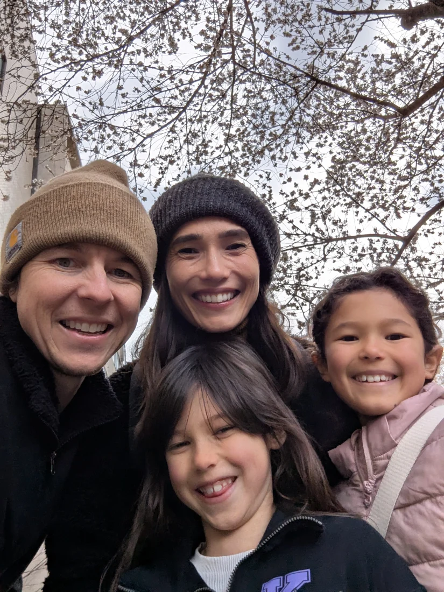
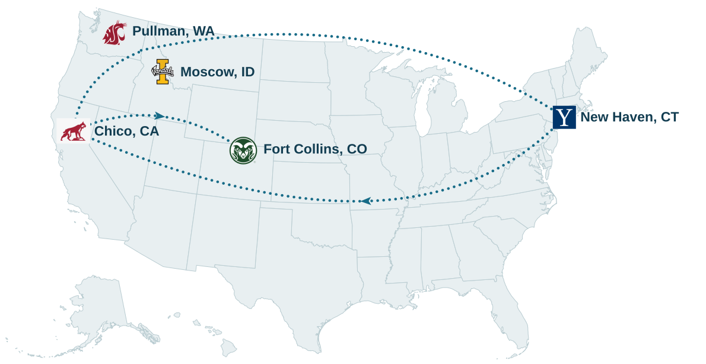
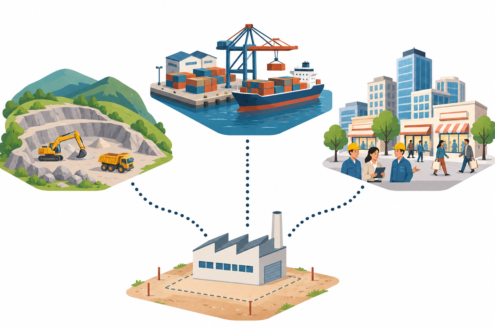

## A little about me {.about-me}

**Jude Bayham · Colorado State University**

```{=html}
<div class="photo-collage">
  
  
  
  <div class="family-portrait">
    
  </div>
</div>
```

## My path to Colorado State

{.career-map fig-alt="A dotted route runs from Chico, California (Chico State), through Moscow, Idaho (University of Idaho), and Pullman, Washington (Washington State University), to New Haven, Connecticut (Yale University). It returns to Chico before continuing to Fort Collins, Colorado (Colorado State University). The Pullman and Moscow logos sit on opposite sides of the route."}

::: {.notes}
I returned to Chico State to teach after my postdoc at Yale, then moved to Colorado State.

Sources: [CV](https://webdoc.agsci.colostate.edu/cv/jbayham.pdf), [U.S. Census Bureau state boundaries via U.S. Atlas](https://github.com/topojson/us-atlas), and official marks from [Chico State](https://www.csuchico.edu/about/brand/visual-identity/index.shtml), [University of Idaho Athletics](https://govandals.com/), [Washington State University Athletics](https://wsucougars.com/), [Yale](https://www.yale.edu/), and [Colorado State](https://brand.colostate.edu/symbol/).
:::

## What I teach and research at CSU

**Teaching:** Data driven decision making, economics of outdoor recreation, graduate optimization for economists

**Research**

```{=html}
<div class="research-panels">
  <figure>
    
    <figcaption>Wildfire management</figcaption>
  </figure>
  <figure>
    
    <figcaption>Air quality</figcaption>
  </figure>
  <figure>
    
    <figcaption>Estimating visits with mobile data</figcaption>
  </figure>
</div>
```

::: {.notes}
Describe how wildfire management affects people and places, how air pollution affects health, and how aggregated mobile device locations can help measure visits to recreation sites.

- Hayes Fire in Olympic National Park. [Courtesy U.S. National Parks](https://npgallery.nps.gov/AssetDetail/32275dd6-5c88-4fa0-b4d3-54b769754792).
- PurpleAir sensor in Yosemite National Park. [National Park Service](https://www.nps.gov/subjects/air/howwemeasure-smoke.htm).
- U.S. public lands visitation study map by Merrill and colleagues. [University of Washington](https://natureandhealth.uw.edu/publications/a-national-model-for-estimating-us-public-land-visitation/).
:::

## What this course asks

**Why do firms and people choose particular places?**

Why do some regions grow faster than others?

How can we evaluate a new factory, road, or regional policy?

::: {.takeaway}
No advance reading is expected today. We will build the ideas together.
:::

::: {.notes}
Introduce regional economics through these questions. Do not ask students to recall a reading.
:::

## Motivating example: a new factory
::: {.columns}
::: {.column width="48%"}
A firm plans to open a factory. It needs materials, workers, space, and customers.

::: {.prompt}
Where should it locate?

What impact will it have on the surrounding area?
:::

Discuss with a neighbor, then explain why each matters.

I don't expect you to use the proper/formal economic terms.

:::
::: {.column width="52%"}
{.generated-illustration width="100%" fig-alt="Illustrative factory location choice: dotted routes connect a proposed factory to raw materials, a container port, and a city with workers and customers. No preferred site is indicated."}
:::
:::

::: {.notes}
Ask pairs to discuss and share their ideas. For the location question, group responses into production costs, movement costs, and access to people or firms. Revisit the list in Example 1; do not require a single correct site yet.

For the second question, “What impact will it have on the surrounding area?”, select one or two follow-ups from this menu rather than covering every channel:

- **Jobs and wages:** “Who gets the new jobs—local residents, commuters, or people moving here? What might happen to workers at existing businesses?” Draw out both employment opportunities and competition for workers; factory jobs are not necessarily an equal increase in total local employment.
- **Local businesses:** “What will the factory buy, and where will its workers spend their wages?” Invite examples such as transport, repairs, food, and shops. Ask whether those purchases stay in the area or go elsewhere; benefits depend on local suppliers and spending.
- **Housing and land:** “If more people want to live nearby, what happens to housing demand and rents? Who benefits, and who might struggle?” Contrast owners and renters; the response depends partly on whether new housing can be built.
- **Traffic, services, and environment:** “What else changes when more trucks and workers arrive?” Prompt for congestion, road and water demands, noise, and pollution alongside possible public revenue. These effects depend on the factory's activity and existing capacity.
- **Nearby places and timing:** “Could one town gain activity that another loses? Would construction effects last after the factory opens?” Separate temporary building work from ongoing operations and local gains from gains for the wider region.

If students simply say “good for the economy,” ask: “Good for whom, through what change, and compared with what would happen without the factory?” If incentives arise, ask what else the public money or land could support. Use everyday language; formal terms and models come later.

Close with: “The factory can create opportunities and costs, and those effects can spread beyond its gates. This course will help us trace those changes and assess who gains and who bears the costs.” Treat student responses as hypotheses to investigate, not effects we have already established.

:::

## Course progression

**Location and growth:** why activity concentrates and regions change.

**Regional measurement:** use data to describe places and industries.

**Land, housing, and amenities:** connect location choices to wages and prices.

**Regional models and policy:** trace a shock and interpret its consequences.

::: {.notes}
Map the four stages to M1–2, M3, M4–5, and M6–8. Explain input-output models as tracking purchases between industries; explain computable general equilibrium models as also allowing prices and behavior to adjust. These are previews, not assumed vocabulary. The final stage asks what results mean for people and places.
:::

## Learning outcomes: location and growth

By the end of the course, you will be able to:

**LO1.** Explain how transportation costs, scale economies, and natural advantages shape the location of economic activity and the formation of cities.

**LO2.** Analyze how shared suppliers, labor markets, and knowledge spillovers encourage firms to cluster, and how congestion and other costs limit concentration.

**LO3.** Compare explanations for regional growth and decline, and explain how industrial specialization, productivity, market access, trade, and migration transmit economic changes across regions.

::: {.notes}
Introduce the three outcomes together: explain location, analyze clustering, and compare regional growth. This is a preview; the terminology will be taught during the course. Full wording and stable IDs follow docs/course-prep-step-1-learning-outcomes.md. Introduce course outcomes in this course-introduction deck only; all module decks should omit outcome lists and LO labels.
:::

## Learning outcomes: places and data

By the end of the course, you will be able to:

**LO4.** Explain how household and firm location choices jointly determine wages, rents, and population across places; estimate hedonic models in R to examine how amenities and other location characteristics are reflected in property values, and assess how sorting and omitted variables limit interpretation.

**LO5.** Define an appropriate regional unit and use data with comparable geographic boundaries, years, and sector definitions in R to measure industrial structure, specialization, and economic change.

::: {.notes}
Explain amenities as valued features of a place, hedonic models as relating property prices to characteristics, and sorting as people selecting different locations. Preview comparable regional data and R work. Do not presume advance reading. Full wording and stable IDs follow docs/course-prep-step-1-learning-outcomes.md. Introduce course outcomes in this course-introduction deck only; all module decks should omit outcome lists and LO labels.
:::

## Learning outcomes: models and policy

By the end of the course, you will be able to:

**LO6.** Use supplied data and model structures to conduct input-output and computable general equilibrium (CGE) calculations in R and estimate regional economic impacts; compare how trade leakages, resource constraints, price adjustment, and factor mobility shape the models' results.

**LO7.** Apply regional theory and models to a real-world problem using an explicit baseline and counterfactual; distinguish modeled impacts from causal evidence and welfare changes, assess opportunity costs, externalities, and distributional consequences, and communicate findings and limitations.

::: {.notes}
Explain input-output analysis as tracing industry purchases and CGE as allowing prices and behavior to adjust. Define baseline as the starting situation and counterfactual as the comparison scenario. Distinguish an estimated regional effect from evidence of causation or improved well-being. These are course destinations, not concepts students must already know. Full wording and stable IDs follow docs/course-prep-step-1-learning-outcomes.md. Introduce course outcomes in this course-introduction deck only; all module decks should omit outcome lists and LO labels.
:::

## How we will work

**In class:** explanation, discussion, and guided practice.

**Four problem sets:** calculations and R work, with interpretation.

**Two exams:** reasoning, assumptions, and manageable calculations.

**Materials:** slides guide class; the reader explains examples fully; selected readings provide context.

::: {.notes}
Explain that timed coding is not planned for exams and that there is no standalone project. No preparation from the reader is expected today. Later reading expectations will be stated explicitly. Do not introduce an LMS, submission format, or grading policy that has not been confirmed.
:::

## Syllabus walkthrough and questions

**Course:** November 23–December 18; no class November 24.

**Exams:** December 7 and December 18.

**First problem set:** introduced today and due November 30.

Discuss expectations, access to materials, support, and questions.

::: {.notes}
Open the current syllabus in syllabus/syllabus.md or its PDF; use its confirmed policies and assessment allocations. The instructor will fill in unresolved policies. TODO: confirm remaining policies on collaboration and AI-use rules; late work; permitted exam materials; submission platform and format; classroom/meeting times; office hours and support arrangements. Use the current syllabus for confirmed grading weights, section times, and rooms; leave unresolved policies for the instructor. PS 1 now has a draft World Bank location-choice question; confirm its final wording before assigning it.
:::
