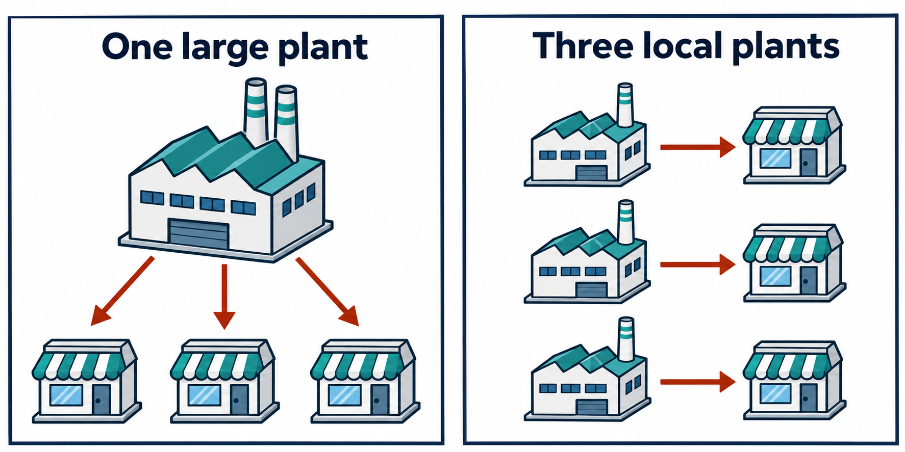

```{r}
#| include: false
source("R/examples.R")
knitr::opts_chunk$set(fig.width = 9, fig.height = 4.3, fig.align = "center")
```

# Regional (and urban) economics

## Regional and urban economics {.scrollable .fields-comparison}

**This course blends both perspectives.**[^location-scope]

[^location-scope]: Here we focus on firms choosing among cities or regions. Detailed strategic positioning relative to competitors within a city is a topic in industrial organization, with overlap in urban economics.

| | Regional economics | Urban economics |
|:--|:--|:--|
| **Focus** | Differences and connections across regions | Why cities form and how activity is organized within them |
| **Questions** | Why do some regions grow while others decline? How do trade and migration connect places? | Why do firms and people cluster? What determines rents, density, and commuting? |
| **Topics** | Growth, specialization, migration, and regional inequality | Agglomeration, housing, land use, transport, and neighborhoods |
| **Policies** | Regional development, infrastructure, and incentives to attract employers | Zoning, transit, congestion pricing, and housing policy |

::: {.takeaway}
Shared ground: location choices, agglomeration, and mobility. A metropolitan area is also a region; the distinction is one of emphasis.
:::

::: {.notes}
5 minutes. Start the 10-minute foundation block.

**Say aloud:** “Our firm-location examples mainly ask which city or region a firm should choose. We are not solving the detailed strategic question of exactly where to locate relative to competitors within a city; that is a spatial-competition topic in industrial organization. The fields overlap: urban economics also studies locations within cities, including land costs and commuting.”

 Define a region as an area relevant to the question, and a city as a concentration of people and activity. Regional economics often emphasizes relationships between places; urban economics often emphasizes concentration and organization within cities. These are overlapping emphases, not rigid boundaries or a rural-versus-urban split. Explain agglomeration as the benefits and costs of locating near other firms and people. For a new factory, contrast choosing Hanoi rather than another region with choosing a site within Hanoi and tracing effects on rents and commuting. Scroll if needed to show the policy row and shared ground. Choose the geographic unit to fit the question; formal boundary measurement waits until Module 3.
:::

## Natural advantages and firm location {.location-advantages}

:::: {.columns}
::: {.column width="30%"}
<div class="advantage-image resource-image">

</div>

A resource deposit can lower input costs.
:::

::: {.column width="30%"}
<div class="advantage-image port-image">

</div>

A port combines geography with built infrastructure.
:::

::: {.column width="30%"}
<div class="advantage-image market-image">

</div>

A large customer base can reduce delivery costs.
:::
::::

::: {.prompt}
Would locating near the cheapest raw-material source necessarily maximize profit?
:::

::: {.notes}
5 minutes. Finish the foundation block. Define natural advantage using a deposit or waterway, production cost as the cost of making output, and freight as the cost of moving goods.

Explain that an advantage in one cost need not minimize the sum. The goal today is to explain a location decision and how scale can concentrate jobs.
:::

## Example 1: three possible plant locations
Supply **1,000 identical units per period** to the same customers.

**Inbound:** inputs to the plant. **Outbound:** products to customers.

```{r}
knitr::kable(base_location[, 1:4], col.names = c("Site", "Production", "Inbound", "Outbound"))
```

All entries are **CU per unit of finished output**. Data are illustrative.

::: {.prompt}
Resource costs $40+2+18=60$ CU per unit.

Now calculate Junction and Market.
:::

::: {.notes}
6 minutes. Walk through the Resource row aloud before students calculate the other two. Define CU as illustrative currency units, a unit as one finished product, and period as the common accounting interval. Output, quality, price, and revenue are identical across sites. Inbound entries already incorporate input requirements; do not multiply again.
:::

## Example 1: add the relevant costs
Let $p_i$ = production, $a_i$ = inbound, and $b_i$ = baseline outbound cost.

$$d_i(\tau)=p_i+a_i+\tau b_i,\qquad \tau=1\text{ initially}.$$

Production + inbound freight + adjusted outbound freight.

```{r}
knitr::kable(base_location[, c("site", "total")], col.names = c("Site", "Baseline cost (CU/unit)"))
```

**Junction saves 3 $\times$ 1000 = `r fmt(3000)` CU per period** relative to either alternative.

::: {.notes}
5 minutes. Define i as the site and tau as a multiplier: 1 means unchanged outbound freight, 0.5 means half. Begin with words, then translate into symbols. Ask students to explain the 3-CU unit saving and convert it to 3000 per period at 1000 units.
:::


## Digression: Profit max or cost min
We have been focused on cost. If revenue is the same at each site:

$$\arg\max_i(R-C_i)=\arg\min_i C_i.$$

If location changes price, quality, or sales, compare **profits**.

::: {.notes}
1 minute. Explain profit as revenue minus cost. With the same revenue at every site, choosing the lowest cost also chooses the highest profit. The next slide makes both the common-revenue assumption and a change to it concrete.
:::

## Digression: what if customers pay for faster delivery?

An order for **1,000 units** pays **70 CU per unit** at either site.

| Site | Price (CU/unit) | Cost (CU/unit) | Profit (CU/unit) |
|---|---:|---:|---:|
| Junction | 70 | 57 | 13 |
| Market | [75]{.fragment data-fragment-index="0"} [70]{.fragment .strike data-fragment-index="0"} | 60 | [15]{.fragment data-fragment-index="0"} [10]{.fragment .strike data-fragment-index="0"} |

::: {.prompt}
The customer offers **75 CU per unit for guaranteed same-day delivery**. Only Market can deliver that quickly. Quantity and listed costs stay unchanged. Which site wins?
:::

::: {.fragment data-fragment-index="0"}
**Market: 75 − 60 = 15 CU/unit**, versus Junction's **13 CU/unit**.

Market earns **2,000 CU more profit** on the 1,000-unit order.
:::

::: {.notes}
3 minutes. Establish the baseline selling price before discussing a premium. Both sites initially earn 70,000 CU in revenue; Junction's cost is 57,000 and Market's is 60,000, giving profits of 13,000 and 10,000. Then change only the customer's payment for delivery from Market: revenue becomes 75,000 and profit 15,000. Junction remains at 13,000. Resource also has baseline cost 60 and cannot meet the premium-delivery requirement, so it does not undercut the comparison.

Allow students to calculate before revealing the answer. The 5-CU premium more than covers Market's 3-CU extra cost. This is an illustrative contract for a fixed quantity, not a claim that a higher price leaves demand unchanged in general. The existing delivered-cost entries already include delivery expenses; no additional same-day cost is assumed. The conceptual slide and this example together retain the original four-minute allocation. Restore identical revenue across sites for the subsequent freight-cost experiment.
:::

## Example 1: outbound freight falls by half
Set $\tau=0.5$; hold production and inbound costs fixed. Also, hold output price fixed.

::: {.prompt}
Which site gains most? Does a cost reduction help every site equally?
:::

::: {.fragment}
```{r}
freight_comparison <- data.frame(
  Site = low_location$site,
  Production = low_location$production,
  Inbound = low_location$inbound,
  Outbound = paste0(low_location$outbound, " × 0.5 = ", low_location$outbound * 0.5),
  Total = low_location$total
)
knitr::kable(freight_comparison,
  col.names = c("Site", "Production", "Inbound", "Adjusted outbound", "New total"),
  align = c("l", "r", "r", "r", "r"))
```

All costs are **CU per unit**. New total = production + inbound + adjusted outbound.

**Resource wins.** All sites become cheaper; their relative advantages change.
:::

::: {.notes}
4 minutes. Remind students that tau=0.5 halves only outbound freight. Calculate Resource together, then have students check Junction and Market before revealing the table. Separate an absolute cost reduction from a change in relative advantage.
:::

## How large does $\tau$ need to be?
The firm is indifferent between Resource and Junction when

$$42+18\tau=49+8\tau.$$

::: {.fragment}
$$\tau^*=0.7,\qquad d_R=d_J=54.6.$$

Check the third site: $d_M=58+2(0.7)=59.4$.

**A pairwise tie is relevant only if no other site is cheaper.**
:::

::: {.notes}
5 minutes. Demonstrate the algebra one step at a time: subtract 8 tau and 42, then divide 7 by 10. Students explain what 0.7 means and check Market. Tau is dimensionless and delivered cost is CU/unit. No reading-based derivation is assumed.
:::

## Min cost location as a function of outbound cost multiplier, $\tau$
```{r}
#| fig-alt: "Three delivered-cost lines. The least-cost site switches from Resource to Junction at tau 0.7 and from Junction to Market at tau 1.5."
plot_location()
```

::: {.prompt}
Why can cheaper transport make production farther from customers more attractive?[^location-reading]
:::

[^location-reading]: For more explanation: reader, “Natural advantages and firm location”; Brueckner §1.4.

::: {.notes}
3 minutes. Explain each axis, then read costs at tau=1 before discussing intersections. The lowest line identifies the preferred site. Intercepts are production plus inbound costs and slopes are baseline outbound costs. At the Resource–Market intersection, Junction is cheaper than both.
:::


## Extension
:::{.prompt}
Suppose an improvement in input transport reduces inbound costs by 50% at every site. Which site is now preferred?

At what inbound cost multiplier would the preferred site switch?
:::

Start from the **baseline costs** below; keep production and outbound costs unchanged.

```{r}
knitr::kable(base_location[, c("site", "production", "inbound", "outbound")],
  col.names = c("Site", "Production", "Baseline inbound", "Outbound"),
  align = c("l", "r", "r", "r"))
```


::: {.notes}
5 minutes across this slide and the follow-up graph: allow 3 minutes for calculation here and 2 for interpreting the lower envelope. Show the baseline cost structure and ask students to identify the new preferred site. The reduction in inbound costs will shift the cost curves downward, potentially changing the location of the minimum-cost site.
:::

## Extension: the inbound-cost lower envelope

Vary inbound costs only: $d_i(\sigma)=p_i+\sigma a_i+b_i$.

```{r}
#| fig-height: 4.3
#| out-height: "460px"
#| fig-alt: "Delivered costs versus inbound freight multiplier. Market is cheapest below 0.25, Junction from 0.25 to 1.75, and Resource above 1.75, with ties at the boundaries. At 0.5, Resource costs 59, Junction 54, and Market 55 CU per unit."
plot_inbound_location()
```

At $\sigma=0.5$: **Resource 59 · Junction 54 · Market 55 CU/unit. Junction still wins.**

::: {.notes}
Use the last 2 minutes of the preceding extension's 5-minute allocation to discuss this graph. Sigma multiplies inbound freight; outbound freight remains at baseline (tau=1). The dashed marker at 0.5 corresponds to the exercise. Each slope is baseline inbound freight, and each intercept is production plus outbound freight.

The lines are Resource: 58+2 sigma; Junction: 51+6 sigma; Market: 50+10 sigma. Market and Junction tie at sigma=0.25 (both 52.5), while Resource costs 58.5. Junction and Resource tie at sigma=1.75 (both 61.5), while Market costs 67.5. Market is cheapest below 0.25, Junction between 0.25 and 1.75, and Resource above 1.75; both neighboring alternatives tie at each boundary. The Resource–Market intersection at sigma=1 is not on the lower envelope because Junction is cheaper.

At sigma=0.5, Market has the largest saving (5 CU/unit), but Junction remains cheapest at 54. Emphasize the difference between benefiting most from a change and becoming the preferred site. Compare with the earlier outbound-cost reduction, which favored Resource.
:::

# Economies of scale

## From choosing a location to choosing a scale

**Example 1:** Where should one plant locate? We took its output and production costs as given.

**Next question:** Could producing together lower costs compared with many small operations?

::: {.prompt}
Why have a large factory at all?

Why not produce near every customer?
:::

First explore **scale economies**.

Then bring shipping costs back into the decision.

::: {.notes}
1 minute; begin the existing 25-minute scale block. Say: “Our first example compared sites for a plant we had already decided to build. It did not explain why production belongs in one large plant. Producing close to each customer could save freight—but would we give up something in production?” Take one brief response. Introduce scale economies as greater efficiency at a larger production scale. The basket story isolates that benefit; Example 2 then compares one plant with two while restoring shipping costs. This minute comes from the basket-story introduction, keeping the total block at 25 minutes.
:::


## Scale economies

An island has **100 basket makers** and reeds available as needed (elastic supply).

Alone, each worker gathers reeds, prepares them, weaves, and packs.

In a factory, workers can specialize in different tasks.

::: {.prompt}
Could the same 100 workers produce more baskets by working together? Why?
:::

::: {.notes}
1 minute; continue the scale block. Tell the story before displaying a curve. Division of labor can raise output per worker. Hold total workers fixed; reeds are available as needed, not fixed in quantity. Initially set aside transport, demand constraints, and housing. This is an illustrative technology, not measured basket-industry data.
:::

## Scale economies: read output per worker {.basket-scale}

::: {.r-stack}
```{r}
#| fig-alt: "Illustrative production curve with point A at 25 workers and 150 baskets. Its ray from the origin has slope 6 baskets per worker."
plot_baskets(1)
```

::: {.fragment}
```{r}
#| fig-alt: "Point B at 100 workers and 1100 baskets has a steeper origin ray: 11 baskets per worker, compared with 6 at A."
plot_baskets(2)
```
:::
:::

::: {.notes}
3 minutes. Start with A: output per worker is Q/L = 150/25 = 6. Ask students to predict the ray for a larger factory; advance once to reveal B and its ray, 1100/100 = 11. The slope from the origin is average product, not marginal product (the tangent slope). Higher output alone would not establish greater efficiency; the comparison is output per worker. Illustrative Q=L(1+sqrt(L)); students need not use that formula. The reader provides the completed static figure.
:::

## Scale economies: compare the same workforce

| Arrangement | Plants | Workers per plant | Baskets per worker | Total baskets |
|---|---:|---:|---:|---:|
| Separate workshops | 100 | 1 | `r basket_table$Output_per_worker[1]` | `r fmt(basket_table$Total_output[1])` |
| One factory | 1 | 100 | `r basket_table$Output_per_worker[2]` | `r fmt(basket_table$Total_output[2])` |

**Total output = plants × workers per plant × output per worker.**

Same 100 workers; greater output per worker raises total output.

::: {.notes}
2 minutes. Ask students to account for all 100 workers in both rows before calculating output. These illustrative values use the same technology as the figure; the one-worker point has Q/L=2. Holding labor fixed and comparing output differs from our next exercise, which holds the order fixed and compares costs. No claim that extra output sells at an unchanged price is needed for the physical-output comparison.
:::

## One large plant or many small plants?
{.generated-illustration height=470 fig-alt="Left: one large factory sends goods to three markets. Right: three smaller plants each supply a local market. The number of markets is the same."}

::: {.notes}
Use this visual as the transition into Example 2. Both arrangements serve the same markets. Ask what is saved by centralizing and what must travel farther. The next calculation uses two markets to keep the arithmetic simple. The short local arrows represent delivery; local freight is normalized to zero in that example.
:::

## Example 2: from output to cost

Now hold required output fixed and compare **one plant versus two**.

A plant pays fixed operating cost $F$ and $c$ per unit produced:

$$C(Q)=F+cQ,\qquad AC(Q)=F/Q+c.$$

With $F=1{,}200$ and $c=20$, production cost per unit is:

**100 units: 32 CU. 200 units: 26 CU.**

::: {.notes}
3 minutes.

Ask whether everyone is comfortable with fixed vs variable costs. Is this short run or long run? Short because fixed costs imply that the plant is already built.

This is a second illustration of internal scale: spreading an avoidable fixed cost. It is not the same production function as the basket story. Define Q, F, and c; calculate 1200/100+20 and 1200/200+20 aloud. No derivative is needed. Distinguish avoidable operating costs from sunk expenses. Average cost excludes freight here.
:::

## Example 2: two markets, one order {.two-arrangements}

```{r}
#| fig-height: 4.3
#| out-height: "460px"
#| fig-alt: "Two markets demand 100 units each. A centralized plant in A makes 200 units and ships 100 to B. Alternatively each market has its own 100-unit plant."
plot_market_map(show_both = TRUE)
```

**Same revenue · identical input access · no capacity limits.**

::: {.notes}
2 minutes. Both arrangements serve 200 units. One plant can be in either identical market. Ask which units travel between markets. Local freight is normalized to zero. First compare production alone, then add intermarket shipping.
:::

## Example 2: first compare production

| Production costs (CU/period) | One plant | Two plants |
|---|---:|---:|
| Fixed operating costs | 1,200 | 2,400 |
| Variable costs: 200 × 20 | 4,000 | 4,000 |
| **Total before freight** | **`r fmt(plant_costs(0)["centralized"])`** | **`r fmt(plant_costs(0)["dispersed"])`** |

::: {.fragment}
**One plant saves 1,200 CU: one avoidable fixed cost.**
:::

::: {.notes}
2 minutes. Show the accounting before symbolic cost expressions. Ask students why variable cost is unchanged and which cost is paid twice. For now t=0. Both total output and revenue are fixed.
:::

## Example 2: now add shipping

Shipping costs **4 CU per unit** to the other market.

One plant ships 100 units: **4 × 100 = 400 CU**.

$$C_1=F+2cq+tq=1{,}200+4{,}000+400=5{,}600.$$

$$C_2=2F+2cq=2{,}400+4{,}000=6{,}400.$$

::: {.fragment}
**Save 1,200 in production; spend 400 on freight. Net saving: 800 CU.**
:::

::: {.notes}
3 minutes. Define q as demand per market and t as the rate per shipped unit. Why is freight charged on 100 rather than 200 units? Centralized average production cost is 26, while delivered average cost is 28. The fixed cost saving outweighs freight at this rate.
:::

## Example 2: when would two plants be preferred?

::: {.prompt}
What freight bill would exhaust the 1,200 CU production saving?
:::

::: {.fragment}
$$C_1-C_2= (F+2cq+tq)-(2F+2cq)=F-tq.$$

Centralize when $tq<F$; disperse when $tq>F$.

$$t^*=F/q=1{,}200/100=12\text{ CU per unit shipped}.$$
:::

::: {.notes}
5 minutes. Let students reason from the 1200-CU saving and 100 shipped units before revealing the algebra. At t=12 both alternatives cost 6400. At t=16 one plant costs 6800 and two cost 6400. Check units: compare a freight bill per period with a fixed cost per period, not a rate with a total. Production concentration is favored by strong scale savings relative to freight; dispersion is not itself evidence of underdevelopment. Detailed cost plots remain in the reader.
:::

## Digression: From a large plant to a city
1. Scale economies concentrate production and jobs in a large plant.

2. Commuting time and expense encourage workers to live near those jobs.

3. Workers’ spending supports nearby shops and services.

But this example does not determine city size or explain why many independent firms cluster.[^scale-reading]

[^scale-reading]: For more explanation: reader, “Scale economies and city formation”; Brueckner §§1.2 and 1.5.

::: {.notes}
3 minutes. End the 25-minute scale block. Explain the jobs-to-residences connection without claiming to solve city size. Many independent firms clustering is the next meeting’s question. Housing and spatial equilibrium return in M4.
:::

## Costs change. Should the firm still centralize?
Keep demand at **100 units per market** and variable cost at **20 CU/unit**.

Now fixed cost falls to **600 CU per plant** and shipping costs **8 CU/unit**.

1. Predict: one plant or two?
2. Calculate each total cost. What saving must cover the freight bill?
3. Compare your reasoning with a neighbor. Why does the preferred arrangement change?

::: {.notes}
20 minutes: 3 for prediction, 8 for paired hand calculations, 6 for comparing explanations, and 3 for questions and feedback. Students need paper and optionally a calculator; no coding or setup. This applies the scale-versus-shipping comparison to a new scenario.

One plant costs 600 + 20(200) + 8(100) = 5,400 CU per period; two plants cost 2(600) + 20(200) = 5,200. Two plants win by 200. The avoided fixed cost is 600, while freight is 800; the threshold is F/q=6 CU/unit. Both lower fixed cost and higher shipping favor dispersion. Ask students to identify both changes. The reader supplies the worked answer.

End November 23 here after 120 working minutes plus the 10-minute break. No class on November 24; the required readings provide follow-up between meetings. Resume with agglomeration on November 25. The summary and retrieval questions remain at the module's end.
:::

## Agglomeration mechanisms

Internal scale: change the plant's own output.

Agglomeration: change nearby activity while holding its own scale fixed.

::: {.prompt}
**Cheaper inputs:** lower search or service costs.

**More productive inputs:** better worker–job matches; learning through **knowledge spillovers**.


Could a larger labor market provide both cheaper and more productive inputs?
:::

::: {.notes}
5 minutes. Begin the 30-minute agglomeration block. Retrieve internal scale from class. Brueckner calls the cost channel pecuniary and the productivity channel technological. These are channels, while suppliers, labor, and knowledge are mechanisms that may overlap. A deeper labor market can reduce recruitment spending and improve worker-job matches. Hold the focal firm's own scale fixed. A testing laboratory may have internal scale economies while its customers gain an external location advantage.
:::


## Cheaper inputs: shared suppliers
Many precision-component firms support a specialist testing laboratory.

**More local customers → viable specialist → access to equipment and expertise.**

Proximity helps when samples, turnaround time, and coordination matter.

::: {.prompt}
Would the advantage remain if testing could be supplied equally well from anywhere?
:::

::: {.notes}
6 minutes. This is a generic hypothetical cluster. Discuss demand aggregation and the specialist's fixed costs. More local suppliers may also compete on prices; service availability and competition are distinct possible benefits. A purchased input can generate a pecuniary agglomeration advantage; not every advantage is an uncompensated spillover.
:::

## More productive inputs: labor pooling and matching
A deep market can improve matching and reduce vacancy time.

Workers have alternative employers; firms have alternative recruits.

**Higher wages can coexist with lower labor cost per effective unit of output.**

::: {.prompt}
If recruitment and interviews move online, which benefit of proximity weakens? Which might remain?
:::

::: {.notes}
5 minutes. Keep this introduction brief; revisit digital communication in the paired exercise after the evidence slide. Online recruitment may reduce search and travel costs without eliminating local skill matching, face-to-face coordination, or worker mobility. Treat the net location effect as a question, not an established prediction.

Ask students to distinguish wage rates from productivity-adjusted costs.

Explain that pooling works best for idiosyncratic fluctuations; correlated industry shocks weaken it.

Connect to specialization and diversity later.
:::

## More productive inputs: Knowledge spillovers

Firm A develops a method that reduces defects. **How might Firm B learn?**

- **Paid advice**:  B pays A to teach the method: a purchased service.
-  **Informal exchange**:  A conversation gives B a useful idea; A is not paid for B's gain. 
- Some combination of the two

**Proximity → opportunities to exchange ideas → higher productivity.**[^knowledge]


Informal exchange helps explain why agglomoration benefits may exceed what is reflected in market prices for paid services.


[^knowledge]: Brueckner §1.3; reader, “Agglomeration mechanisms.”

::: {.notes}
6 minutes. This is the productivity channel in the overview: knowledge spillovers can make a given workforce more productive. They are not a third channel separate from cheaper and more productive inputs.

Walk through the same defect-reduction idea in three settings. First, B hires A to explain the method and pays for that service. This is learning through a market transaction; proximity could lower consulting costs, but the purchase alone does not establish a spillover. Second, engineers meet at an industry gathering and a general observation helps B improve production. If A is not compensated for that gain, this illustrates an external knowledge benefit. No disclosure of confidential information is assumed.

Third, paid advice can generate additional learning. B might use a general insight on a different production line. That could be a spillover if the additional benefit was not fully accounted for in the compensation or agreement; reuse alone does not prove it. The categories can overlap. Buying advice is one way to learn, not the opposite of learning.

“Not fully paid for” does not mean A earns nothing: A can benefit from its own method and receive consulting fees while some benefits accrue to others without full compensation. Emphasize the concrete mechanism before the externality terminology. Geographic proximity matters only if it facilitates the relevant interaction or exchange of difficult-to-codify knowledge. Ask students to identify the idea, its recipient, and the productivity change rather than assuming that all conversations or clusters create spillovers.
:::

## Example 3: distinguish mechanisms with evidence
| Mechanism | Useful observations |
|---|---|
| Supplier sharing | Service availability, purchases, turnaround times |
| Matching | Vacancy duration, worker transitions, skill matches |
| Learning | Knowledge transmission and subsequent productivity |

**A cluster's existence does not identify its cause.**[^agglomeration-reading]

[^agglomeration-reading]: For more explanation: reader, “Agglomeration mechanisms”; Brueckner §1.3.

::: {.notes}
3 minutes. Briefly connect each mechanism to one useful observation. These observations are starting points; causal designs need more than correlations. The following exercise lets students apply the distinctions.
:::

## Exercise: does cheaper communication eliminate cities?

Imagine online recruitment, video meetings, and sharing technical documents become **free and perfectly reliable**.

::: {.prompt}
Would firms still benefit from locating near one another?
:::

With a partner, identify:

1. **One benefit of proximity that weakens.** Explain the mechanism.
2. **One benefit that remains.** Explain why being nearby still helps.

Choose a concrete activity: manufacturing, software, or business services.

::: {.notes}
5 minutes: 1 minute individual thought, 2 minutes paired discussion, 2 minutes collecting contrasting answers. This ends the 30-minute agglomeration block; use 3 minutes rather than 6 on the preceding evidence slide and 5 rather than 7 on labor matching to make room. No advance reading or numerical calculation is needed.

Present this as a deliberately strong hypothetical motivated by familiar digital tools, not a claim that current tools are free or perfect. Only the listed communication services change. Moving goods and people still costs time and money; workers' skills and firms' production technologies are otherwise unchanged.

Possible weakened benefits: recruitment travel and search costs, routine coordination, and transmitting codified information. Possible remaining benefits: access to physical inputs, urgent equipment repairs, hands-on learning and observation, and the ability to change employers without relocating. Free, reliable transmission does not mean that all practical knowledge can be written down or demonstrated remotely. Informal encounters might still matter, but students must explain what they enable rather than simply asserting that face-to-face contact is better.

Ask: “What exactly becomes cheaper or more productive? Which cost or difficulty has not changed?” Accept different predictions across industries when the mechanism is clear. A software team and a factory needing same-day repairs may give different answers. Do not require a yes/no verdict about the disappearance of cities or assume that digital tools eliminate all spillovers.

Close by collecting one weakened benefit and one persistent benefit. Transition: “If some benefits of proximity shrink while rents and congestion remain, how might the location decision change?” The next slide compares agglomeration benefits with those costs.
:::

## Growth also brings costs
Supplier and matching gains: $6+4=10$ CU/unit.

Occupancy and congestion costs: $5+3=8$ CU/unit.

**Net private advantage: 2 CU/unit.**

::: {.prompt}
An extra 3 CU/unit of congestion reverses the ranking. Does this accounting establish an optimal city size?
:::

::: {.notes}
5 minutes. Begin the unchanged 20-minute block. The accounting does not establish an optimal city size. Numbers are illustrative and omit effects on other residents and firms. Distinguish rent payments, resource costs, and external effects.
:::

## Cities: Specialization versus diversity
**Localization economies:** benefits linked to a concentration of a particular activity.

**Urbanization economies:** benefits of broader urban scale and cross-industry connections.

::: {.prompt}
Which structure helps a specialized manufacturer? Which offers resilience to an industry-specific downturn?
:::

No universal winner: identify the mechanism and the relevant shocks.

::: {.notes}
5 minutes. Avoid treating diversity as automatically innovative or specialization as necessarily fragile. Supplier specificity, skill transferability, and shock correlation matter.
:::

## Vietnam: connectivity shapes concentration

Transport and logistics connect places to opportunities for growth, inclusion, and resilience.[^vietnam-report]

- **Location:** northern industrial parks cluster along the Hanoi–Haiphong corridor.
- **Agglomeration and limits:** access to firms and workers can help; gateway congestion adds costs.
- **Digital versus physical:** online commerce still needs warehouses and last-mile delivery.

::: {.prompt}
Would a better transport link strengthen a cluster—or make serving it from farther away easier?
:::

[^vietnam-report]: [World Bank, *Connecting Vietnam for Growth and Shared Prosperity*](https://documents1.worldbank.org/curated/en/590451578409008253/pdf/Vietnam-Development-Report-2019-Connecting-Vietnam-for-Growth-and-Shared-Prosperity.pdf), executive summary; Ch. 2, pp. 43–49; Ch. 3, pp. 61–73. Historical evidence, not current estimates.

::: {.notes}
5 minutes: 1 minute report overview, 2 minutes connecting findings to today's examples, 2 minutes discussion. The report is dated December 2019, copyright 2020. Treat its observations as historical; do not describe its projections or infrastructure plans as current outcomes.

**Report overview.** The report examines connections to global and domestic markets, access for less-connected places, and resilience to disruptions. It recommends coordinated transport and land-use planning, better logistics services, and attention to inclusion and reliability—not simply more road construction. Executive summary, printed pp. 1–9.

**Location and clustering.** Chapter 2, pp. 43–49, examines northern industrial parks in relation to transport corridors, urban labor markets, neighboring parks, and gateways. Many lie along National Highway 5 between Hanoi and Haiphong. Ask students to map these relationships onto inbound freight, outbound freight, supplier access, and labor matching. A map cannot tell us how much of the pattern reflects each mechanism, and it does not demonstrate knowledge spillovers. Figure 4.1, p. 79, provides the broader population/economic-activity pattern around Hanoi and Ho Chi Minh City.

**Concentration has costs.** The report identifies capacity bottlenecks and congestion at major gateways. Connect this to the earlier net-benefit calculation: a convenient cluster can also impose delivery delays. Distinguish a port's own scale efficiencies from benefits that nearby independent firms obtain. The policy question is which bottleneck to address, not whether every locality should build its own gateway.

**Digital tools still need physical networks.** Chapter 3, pp. 61–73, discusses e-commerce and urban logistics; the World Bank's January 15, 2020 launch summary emphasizes door-to-door and last-mile delivery needs. Return to the communication exercise: online ordering can reduce search costs while goods still need storage, handling, and delivery. Ask which cost disappears and which remains.

**Discussion and bridge.** The final prompt is an application of our models, not a causal finding from the report. Lower outbound costs made Resource competitive in Example 1; lower inbound costs helped Market most without making it the winner at a 50% reduction. Better connections may support an existing cluster or extend the range over which distant producers compete. The answer depends on the affected costs and other responses. Module 2 considers how those changes affect regional growth and who benefits.
:::

## Module 1: what explains concentration?

**Location:** compare production, inbound, and outbound costs; revenue differences can change the choice.

**Internal scale:** a larger plant can save production costs, but serving distant customers adds freight.

**Agglomeration:** nearby suppliers, workers, and ideas can benefit separate firms.

**Limits:** land costs and congestion can offset those benefits; clustering alone does create ambiguous benefits.

::: {.notes}
2 minutes of the final 10-minute block. This is the module's consolidated summary, replacing the removed midpoint recap. Connect each statement to Examples 1, 2, and 3. Emphasize that the conclusion depends on what changes and what is held fixed.
:::


## Module 2 preview: return to the new factory

We can now explain **why the factory might choose a place**.

::: {.prompt}
If it opens, how might the surrounding region change over time?
:::

**Purchases and trade · jobs and migration · productivity and investment**

A profitable location for one firm does not establish gains for every resident.

::: {.notes}
3 minutes. Return to the opening factory slide's second question. Invite two possible changes, then ask what the location examples held fixed that would now need to adjust: output, wages, prices, population, or other firms' decisions. Purchases may support suppliers locally or elsewhere; jobs may attract commuters or migrants; productivity and investment may respond. These are channels to investigate, not guaranteed effects.

Module 2 studies regional growth and connections through trade, migration, and productivity. Separate a firm's location choice from regional employment growth and residents' welfare. This completes Module 1's 60 working minutes on November 25, leaving 60 for Module 2. No additional recap is needed before proceeding.
:::

## Readings and further explanation

**Required:** regional framing and location.[^required-location]

**Required:** scale economies, agglomeration, and transport.[^required-scale]

**Supplemental and optional:** external economies, retail clustering, advanced theory, and a Vietnam application.[^further-reading]

Worked answers and a full bibliography are available for follow-up.[^companion]

[^required-location]: Hoover–Giarratani, Ch. 1, pp. 12–15; Ch. 2, §§2.3–2.7, pp. 19–35 [@hoover2020].
[^required-scale]: Brueckner, Ch. 1, §§1.1–1.5, pp. 1–18 [@brueckner2011].
[^further-reading]: Supplemental: Hoover–Giarratani, Ch. 5, §§5.2–5.4, pp. 84–96; Brueckner §1.6. Optional advanced: Glaeser–Gottlieb, §3, pp. 999–1015 [@glaeser2009]. Optional application: World Bank, Ch. 4, Fig. 4.1, p. 79 [@worldbank2020].
[^companion]: Companion reader, “Readings and references,” plus the worked examples and practice answers.

::: {.notes}
Reference slide, no additional teaching time. Page references use printed numbering. No advance reading is assumed on Day 1; the interval between meetings allows students to catch up. Hoover–Giarratani supplies the regional framing, resource endowments, and location factors used in the opening material. Brueckner supplies the main scale/agglomeration treatment and transport connections. Only the listed selections are required, not the full books or all supplemental passages. No additional submission is assigned.
:::

::: {#refs .hidden}
:::
## Optional backup: double demand in both markets
Keep $F=1{,}200$, $c=20$, and $t=4$; set $q=200$.

::: {.prompt}
Does a larger market necessarily strengthen the case for centralization?
:::

::: {.fragment}
One plant: **10,000** CU. Two plants: **10,400** CU.

The saving falls to **400**: more units cross between markets, but the avoided fixed cost is unchanged.
:::

::: {.notes}
Optional backup, no scheduled minutes. Use only after the main lesson if time permits, or as voluntary review. Allow students to predict before checking plant_costs(t=4,q=200). Total output rises to 400. This example also appears in the reader’s Practice B.
:::

## Optional extension: why do competing shops cluster?

Nearby shops can save customers trips and make comparison easier.

They may also compete more intensely on price.

::: {.prompt}
Which advantage changes when customers can compare products online?
:::

A mall owner can account for cross-store benefits through tenant mix and rents.[^retail-reading]

[^retail-reading]: Optional explanation: reader, “Retail clustering”; Brueckner §1.6 (supplemental).

::: {.notes}
Optional, no scheduled minutes. Distinguish shared trips, comparison shopping, and competition. Some cross-store customer flows benefit neighboring shops; a common owner may account for some of these effects. Online search may reduce one benefit of proximity, but the net effect is not predetermined. This does not expand the required reading beyond §§1.1–1.5.
:::
