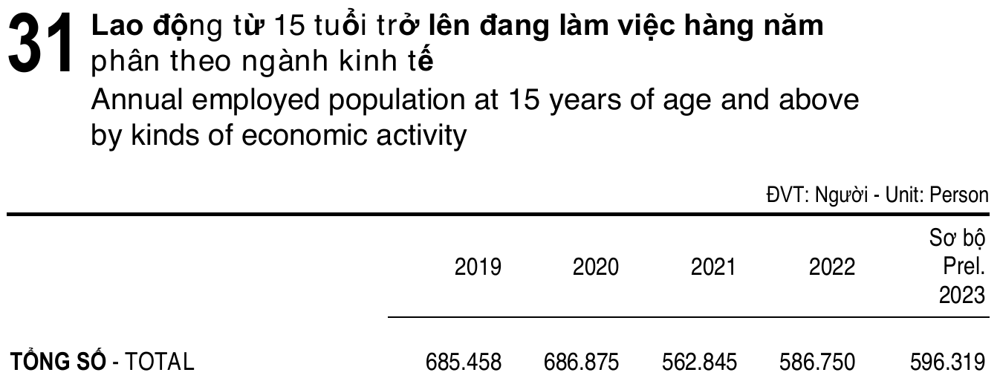

## What defines a region?

Choose a boundary that fits the question.

- **Administrative region.** A district government collects taxes inside its jurisdiction.
- **Functional region.** A labor market can span several districts when people commute between them.
- **Shared characteristic.** A rice-growing belt can cross district lines because farms share similar growing conditions.

::: {.prompt}
A worker lives in River and works in Harbor. Where would you count the job? Where would you count the household’s earnings?
:::

::: {.notes}
Count the job in Harbor using workplace data and the household’s earnings in River using residence data. Ask students what happens if they draw one boundary around the whole commuting area. The workplace and the household now fall inside it.

**Reading guide.** Module 2 reader, pp. 3–4, introduces boundaries. Schaffer, ch. 2, pp. 6–9, discusses ways to define a region.
:::

## What initiates a region’s growth?

**Demand.** Harbor orders more rice. River’s mill can raise output this week by putting an idle machine and an extra shift to work.

**Supply.** A second milling machine and training let the mill produce more even after both shifts are full. Across River, output per worker can also rise as workers move into more productive industries.

::: {.prompt}
Suppose River ships more rice this year. What evidence would tell you whether the mill used spare capacity or expanded its capacity?
:::

::: {.notes}
For the demand response, look for additional orders, longer hours, and higher utilization of existing machines. For a capacity change, look for new equipment, skills, or higher output per hour. A persistent increase in demand can lead to investment, so both explanations can apply at different horizons.

**Reading guide.** Module 2 reader, pp. 5–8, connects regional productivity to the mix of jobs. Hoover and Giarratani, §11.2, discusses demand and supply explanations for regional growth.
:::

## How can exports in one industry impact other industries in the region?

Harbor buys rice from River’s mill. Two kinds of spending spread the effect through River.

- **Supplier purchases.** The mill hires a local repair shop. The shop gains sales even though all its customers are in River.
- **Household spending.** Mill workers spend some of their extra wages at River’s grocery. Part of those sales becomes income for local workers and owners.

::: {.prompt}
If the grocery restocks from a supplier in Harbor, what happens to the share of each sale that returns as income in River?
:::

::: {.notes}
Trace the payments from buyer to mill, mill to worker, worker to grocer, and grocer to supplier. Holding the grocery sale fixed, a larger share paid for outside inputs leaves less available as River income. In the Module 2 example, households spent 80% of new income locally and 75% of that spending became resident income. The feedback coefficient was 0.80 × 0.75 = 0.60. Ask students to carry that reasoning into the seafood case with its own spending shares.

**Reading guide.** Module 2 reader, pp. 9–15, follows export demand through suppliers and household spending and develops the income multiplier.
:::

## Should the seafood processor take the order?

A processor in a fictional Mekong Delta district can sell **20,000 kg of frozen fish each week** at **100,000 VND per kg**. The buyer, a supermarket outside the district, will take only the full shipment.

- The regular shift can handle **14,000 kg**. The last **6,000 kg** need overtime and rented cold storage.
- A better freight connection cuts shipping from **14,000 to 10,000 VND per kg**.

::: {.prompt}
Would you sign the contract? What part of the buyer’s payment will district residents earn?
:::

[handout (PDF)](seafood-order.pdf){target="_blank"}

::: {.notes}
Allow about 20 minutes. Take an initial vote, then give pairs the cost table on page 1. At the old freight rate the margins are −1,000 and −9,000 VND per kg, yielding a weekly loss of 68 million VND. With the improvement the margins are +3,000 and −5,000. The first 14,000 kg earn 42 million VND, the last 6,000 kg lose 30 million, and the full order contributes 12 million. The buyer rules out shipping only the first 14,000 kg.

Ask who receives the 2 billion VND in weekly gross sales before students turn to page 2. Local farm receipts cover costs and can replace earlier sales. Commuter wages go to households in the neighboring district. The 58 million is the supplied net gain across resident workers and owners before household spending. It already includes relevant earnings from the processor and farms.

Of the 58 million, 40.6 million is spent locally and 24.36 million returns as resident income. The feedback coefficient is 0.42. The following round generates 10.2312 million. The multiplier is 1/0.58, or about 1.72. Total resident income rises by 100 million VND per week, including the initial 58 million.

For the closing question, overtime can raise shipments at the same headcount. Compare weekly kilograms shipped or real value added at the plant with household real income by place of residence. Invite students to justify a district or commuting-area boundary and name a provincial or national industry share for comparison. This introduces the location quotient.

**Reading guide.** Module 2 reader, pp. 12–15, works through income feedback. Schaffer, ch. 3, Note A, pp. 43–45, introduces location quotients and shift-share.
:::

## What makes an industry important to a region?

The importance of an industry to a region can be assessed through several key indicators:

1. Which industries account for the region’s employment and output?
2. Which industries are unusually concentrated relative to a benchmark?
3. How much local growth would we expect if industries followed national trends?

Define these indicators then apply them to Cần Thơ.

::: {.notes}
Use the opening exercise to move from a decision at one plant to a description of the district. Keep the boundary, measure and benchmark explicit throughout the lecture. Schaffer references use printed pages (add 10 for the course PDF). For Hoover and Giarratani add 1. Module 3 reader references use its PDF pages.

**Reading guide.** Schaffer, ch. 3, pp. 43–46, connects measurement to the questions an area profile should answer.
:::

## Sectoral composition {.center .concept data-background-color="#eaf2f3"}

Which industries account for the region’s employment and output?

::: {.notes}
Connect the mix of sectors to Module 2’s example of workers moving between industries. A planner needs to know which sectors employ residents and where businesses generate value added.

**Reading guide.** Hoover and Giarratani, §9.4, pp. 187–189, connects a region’s industry mix to opportunities for residents. Module 2 reader, pp. 7–8, illustrates sector reallocation.
:::

## What does each sector contribute?
<!-- potentially include why this is relevant to decision makers -->
Choose a boundary and a measure. Administrative, commuting,...

Let $x_{ir}$ be industry $i$’s activity in region $r$ 

$X_r=\sum_i x_{ir}$ is the regional total 

**sector share** is $s_{ir}=x_{ir}/X_r$.

Sector shares can tell us which workers might be affected by a downturn and which industries account for local production.

::: {.notes}
A city workforce office may want an administrative boundary for its residents and a commuting area for potential recruits. Confirm whether the data count employed people or payroll jobs. The shares sum to one for an exhaustive set of mutually exclusive industries on the same basis.

**Reading guide.** Schaffer, pp. 6–9, links boundaries to the question. Hoover and Giarratani, pp. 187–189, compares sector mixes measured in several ways.
:::

## Relative specialization {.center .concept data-background-color="#eaf2f3"}

Which industries are unusually concentrated relative to a benchmark?

::: {.notes}
A large retailer might employ many people in nearly every city. Ask what part of its employment a city of this size would ordinarily have. A benchmark puts the local share in context.

**Reading guide.** Schaffer, pp. 19–21 and 43, introduces benchmark activity and discusses when a large share warrants further investigation.
:::

## Location quotient

The location quotient (LQ) measures the degree to which an industry is concentrated in a region relative to a benchmark.

The benchmark is often a larger region, such as a province or the nation.

## Deriving the location quotient

Choose a measure $x$ such as jobs or value added. 

Let $x_{ir}$ be industry $i$’s amount in region $r$, 

$X_r$ the regional total

$s_{ir}=x_{ir}/X_r$ its share. 

Use $s_{ib}$ for the same share in benchmark $b$.

At the benchmark mix, industry $i$ would account for $X_r s_{ib}$ locally.

::: {.fragment}
$$LQ_{ir|b}=\frac{x_{ir}}{X_r s_{ib}}=\frac{s_{ir}}{s_{ib}}.$$
:::

::: {.fragment}
A LQ of 1.5 means the industry’s share is **50% higher** locally. 

:::

::: {.notes}
The measure, sector definitions, date and industry universe must agree across the two places. Both totals and the benchmark share must be positive. Zero local activity then gives zero; parity gives one. For the output LQ, use total industry value added in both places. For the employment LQ, match the definition of employment in both places. An earnings LQ can likewise use a consistently defined earnings measure.

**Reading guide.** Schaffer, pp. 19–21 and 43, discusses the measure and benchmark and develops the employment case. Hoover and Giarratani, p. 189, supplies the value-added shares. Module 3 reader, p. 3, applies this ratio to jobs.
:::

## What can an LQ tell a planner?

An employment LQ above one means the industry employs a larger share of the workforce locally than it does in the benchmark.

- **Workforce planning.** Pair the employment LQ with the headcount to decide which employers to ask about vacancies and training.
- **Production and trade.** Use the output LQ to see whether the industry also accounts for an unusually large share of production. To identify its markets and understand where its customers are.

A national benchmark compares the city with the country. 

A provincial benchmark asks how the city stands out among nearer locations.

::: {.notes}
Schaffer uses LQs to look for a possible export base when detailed sales by destination are costly to obtain. Differences in local demand, productivity and sourcing can also produce a high share. 

**Reading guide.** Schaffer, pp. 19–21 and 43, explains the export-base interpretation, its assumptions and the further questions an LQ raises. Module 3 reader, pp. 3–4, changes the reference economy.
:::

## Changes in composition and growth {.center .concept data-background-color="#eaf2f3"}

How much local growth would we expect if industries followed national trends?

<!-- A sector gains local share when its own activity grows faster than the regional total. To measure the change in **percentage points**, take $100(s_{ir,1}-s_{ir,0})$ with shares written as fractions. -->

::: {.notes}
A change in a sector’s local share concerns its weight within the city. Comparing growth against national industry trends asks a separate question about how far the local change departed from a benchmark. Build the latter comparison from levels at two dates.

**Reading guide.** Hoover and Giarratani, pp. 189–190 and 279–280, connects industry composition and comparative growth. Module 3 reader, p. 5, distinguishes a local share change from a shift-share component.
:::

## Shift shares

**Shift-share** asks how much a region would have gained if each sector had followed the benchmark. 

Choose an additive measure and call the local industry’s starting amount $x_0$ and ending amount $x_1$.

| Apply to the same $x_0$                  | Implied change    |
| :--------------------------------------- | :---------------- |
| $g$ · overall benchmark growth           | $x_0 g$           |
| $g_i$ · benchmark growth in industry $i$ | $x_0 g_i$         |
| $g_{ir}$ · local growth in that industry | $x_0 g_r (x_1-x_0)$ |
|                                          |                   |

Calculate each rate as $g=(x_1-x_0)/x_0$ for its own series. 

Shift-share can be defined for employment, output, payroll, or hours.

::: {.notes}
A rate is the change divided by the starting amount, written as a decimal. Fixing the local base separates the choice of rate from initial size. Use consistent prices and additive series when measuring real output change. Total payroll or hours also work. Average pay and output per worker are ratios and require their own weights. If local base activity is zero, compute the observed change directly; the local growth rate is undefined. Benchmark rates require positive bases.

**Reading guide.** Hoover and Giarratani, appendix 12-1, printed p. 279, introduces shift-share for employment or value added. Schaffer, Note A, pp. 44–45, constructs employment benchmarks. Module 3 reader, p. 5, works the job version.
:::

## Shift-share decomposition

Let $g_{ir}$ be the growth rate of industry $i$ in region $r$. Its observed change is $x_1-x_0=x_0g_{ir}$ when $x_0>0$.

::: {.fragment}
**Benchmark growth** $N=x_0g$ applies the overall benchmark rate.
:::

::: {.fragment}
**Industry mix** $M=x_0(g_i-g)$ credits the starting amount with the industry’s growth above or below the overall benchmark.
:::

::: {.fragment}
**Regional shift** $S=x_0(g_{ir}-g_i)$ measures how much more or less the local industry gained than it would have at its benchmark growth rate.
:::

::: {.fragment}
The terms sum to $N+M+S=x_1-x_0$. Sum across industries for the regional change. A large regional shift gives a planner a reason to ask local employers what changed.
:::

::: {.notes}
If the industry starts at zero locally, its growth rate is undefined. Use the observed change to calculate $S=(x_1-x_0)-x_0g_i$.

On the board, write x₀g, x₀gᵢ, and the observed change in one column. Use the first entry and the two successive differences. The first two components sum to x₀gᵢ, so adding S recovers the observed change. The regional industry-mix component depends on starting sector weights and benchmark growth rates. It can be positive even when the sector’s local share stays fixed, as the fictional corridor example on p. 5 of the reader illustrates. Use exhaustive, nonoverlapping industries on a common basis. A regional shift is an accounting residual; freight access, staffing or demand would require separate evidence.

**Reading guide.** Schaffer, pp. 44–45, derives and sums the components. Hoover and Giarratani, appendix 12-1, pp. 279–280, explains the role of starting industry mix. Module 3 reader, p. 5, works the employment identity.
:::

## Recap

Sectoral composition describes the region’s industrial structure.

Location quotients describe a region’s industrial structure.

Shift shares provide a useful decomposition of local growth. How much can be atttributed to the benchmark, the industry mix, and a regional shift?

## Cần Thơ’s transportation and storage sector

Suppose Cần Thơ is considering a logistics training program. How important is transportation and storage to local workers and production? Does recent growth warrant talking to employers?

Use **Cần Thơ on its 2022–23 boundary**, with **Viet Nam** as the benchmark. The 2023 yearbooks report 2022 levels and preliminary 2023 figures.

[Open the class workbook in Excel](can-tho-sector-data.xlsx). Enter formulas on **Excel exercise**. The **Sector data** tab contains the published figures and sources.

::: {.notes}
Frame the training proposal as the classroom decision. The yearbook data describe the administrative city before the merger in 2025. The question of a training program's recruiting area would additionally require commuting flows. Students can work in pairs, but each pair should complete both columns.

**Reading guide.** Cần Thơ City Statistical Yearbook 2023, pp. 89–90, 123–124 and 127–128, and Statistical Yearbook of Viet Nam 2023, pp. 168–169, 243–244 and 247–248, report the employment and output series.
:::

## Employment in the Cần Thơ statistical yearbook

::: {.source}
[Cần Thơ City Statistical Yearbook 2023, table 31, p. 89 (PDF)](https://thongkecantho.nso.gov.vn/storage/manager/niengiam_tk/SzJyDEu-aacc0480-ce59-41ec-92d8-3c94220e5886.pdf#page=89). Selected rows. Periods separate thousands.
:::

::: {.notes}
Point to the unit, the year headings and the preliminary label. Ask students to locate the city total and the transportation and storage count for the same year before they open the workbook.

**Reading guide.** Cần Thơ City Statistical Yearbook 2023, printed p. 89, gives these employment counts. Tables 42 and 44 on pp. 123–124 and 127–128 report the corresponding current-price and constant-price production figures.
:::

## Which series belong in each calculation?

| Question | Series in the workbook | Unit |
|:---|:---|:---|
| Employment share, LQ and growth | Employed people aged 15 and older | People |
| Output share and LQ in 2022 | Current-price industry value added | Billion VND at 2022 prices |
| Change in output and its composition, 2022–23 | Industry value added at constant prices in both years | Billion VND at 2010 prices |

The all-industry output total equals GDP (or city GRDP) less product taxes net of subsidies. Use that total as the denominator for industry shares.

::: {.source}
2023 statistical yearbooks for [Cần Thơ](https://thongkecantho.nso.gov.vn/nien-giam-thong-ke/3) (tables 31, 42, 44) and [Viet Nam](https://www.nso.gov.vn/en/default/2024/07/statistical-yearbook-of-2023/) (tables 59, 87, 89).
:::

::: {.notes}
Point out the three measure blocks on Sector data. National employment is converted to people, and city value added to billions of VND. A common price basis for growth removes the change in the valuation of activity attributable to prices.

**Reading guide.** Cần Thơ yearbook, pp. 89–90, 123–124 and 127–128, and Viet Nam yearbook, pp. 168–169, 243–244 and 247–248, distinguish current-price and constant-price accounts.
:::

## Describe the city’s sector mix

Open the [Cần Thơ Excel workbook](can-tho-sector-data.xlsx). On **Excel exercise**, fill rows **6–12** for 2022. Column B measures employment and column C measures current-price value added.

1. On **Sector data**, find the city’s industry and all-industry values for each measure.
2. Divide each industry by the matching city total. 
3. Check that each column totals 100% in row 13. Compare the six named industries. The last row pools the remainder.

::: {.prompt}
Which industry leads on each measure? Which ranking would you use to describe workers’ exposure to a sector downturn?
:::

::: {.notes}
Ask pairs to compare two sectors with different ranks. Look for an explanation in terms of citywide employment or value added. Have them check which activities are combined in the last row before identifying the leading named industry.

**Reading guide.** Hoover and Giarratani, §9.4.2, pp. 188–189, describes industry mix and the choice of measure. Cần Thơ yearbook, pp. 89–90 and 123–124, supplies the data.
:::

## Calculate the two location quotients

For **transportation and storage**, complete rows **17–19**. Keep employment in column B and current-price output in column C.

| Row | Enter a formula for… |
|:---|:---|
| 17 | The Cần Thơ sector share you calculated in row 10 |
| 18 | Viet Nam’s sector total divided by its all-industry total |
| 19 | The city’s share divided by the national share |

::: {.prompt}
Does each LQ fall above or below one? Write a sentence about specialization that a workforce planner and a regional accountant could both defend.
:::

::: {.notes}
Have students label the year, place, reference economy and measure in their sentences. Use the same definition of employment and the same price basis within each quotient. Reserve the numerical comparison for the separate walkthrough.

**Reading guide.** Schaffer, ch. 3, Note A, p. 43, defines the LQ. Module 3 reader, pp. 3–4, illustrates reference shares and expected counts.
:::

## Did the sector gain local share?

Rows **23–30** link to the 2022 and 2023 yearbook levels. Use them to complete rows **32–34** for employment and real output.

1. Divide the city’s sector level by the city total in each year.
2. Subtract the 2022 share from the 2023 share and multiply by 100. Report **percentage points**.
3. Explain how a sector could grow and still lose share in the city economy.

For output, use **2010 prices in both years**. This gives the sector’s weight in real production over time.

::: {.notes}
Give pairs time to inspect the difference between the 2022 output series in the LQ and growth sections. Ask them to distinguish a change in local weight (sector and city total) from a comparison of growth paths (sector and national trends).

**Reading guide.** Hoover and Giarratani, pp. 189–190, discusses comparing distributions. Cần Thơ yearbook, pp. 89–90 and 127–128, gives the employment and real output levels.
:::

## Decompose employment and real output growth

Complete **both columns** on **Excel exercise**. Keep the growth rates unrounded.

| Rows | Calculation |
|:----|:----------------------------------|
| 38–40 | Calculate 2022–23 growth for Viet Nam overall, the national sector, and the city sector. |
| 42–44 | Multiply each rate by the city sector’s 2022 level in row 23. |
| 46–48 | Record the first gain, the second minus the first, and the third minus the second. Label them national growth, industry mix, and regional shift. |
| 49 | Check that the three components sum to the observed change in each column. |

Report column B in **people** and column C in **billion VND at 2010 prices**.

::: {.notes}
Set up the three growth paths on the board with two empty columns. Students should use the same local start within a column and switch the reference rate at each step. Use each check to diagnose a reference or unit error before students discuss their interpretation.

**Reading guide.** Schaffer, pp. 44–45, derives the three components. Hoover and Giarratani, appendix 12-1, pp. 279–281, explains the common-base approach for employment or value added.
:::

## Would you pursue a logistics training program?

Prepare a short briefing for the city.

1. **Sector mix.** Where does transportation and storage fit among the city’s industries?
2. **Specialization.** What do your two 2022 LQs say about employment and output relative to Viet Nam?
3. **Growth.** Compare the city and national sector growth **rates** for each measure. Use each regional shift to express the departure in its own units.

::: {.prompt}
What would you ask employers or workers before committing funds? Name an answer that would change your recommendation.
:::

Module 4 examines how wages, rents and commuting costs shape location choices.

::: {.notes}
Invite pairs to offer competing explanations and identify evidence that would distinguish them. Look for a distinction between employment changes and evidence about particular occupations or skill shortages. A strong brief specifies the measure and the benchmark and states the limits of preliminary annual data.

**Reading guide.** Schaffer, pp. 45–47, discusses writing an area profile that can inform a decision. Module 3 reader, p. 6, connects a benchmark comparison to follow-up questions.
:::

## Optional practice · How far does a hiring boom reach?

Cần Thơ’s sector totals leave a question open. How far does its labor market extend? Commuting flows connect employers with the households that earn the wages. Use the fictional corridor to see how these ties can cross a district line.

Suppose a plant in A hires a worker away from a firm in B. She keeps living in B, earns a higher wage in A, and leaves her former employer in B with a vacancy to fill.

::: {.prompt}
The plant adds 100 jobs. Can A’s mayor conclude that 100 more residents of A are employed? What would you need to know?
:::

::: {.notes}
Use the corridor if time permits. Choose a boundary for a workforce board, then ask for the observations that would allow a valid employment comparison. The optional practice that follows uses synthetic workplace and commuting data.

**Reading guide.** Hoover and Giarratani, §9.1, pp. 176–179, discusses commuting ties. Module 3 reader, p. 1, works the corridor example.
:::

