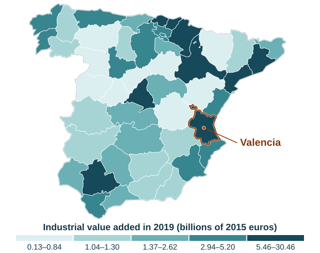
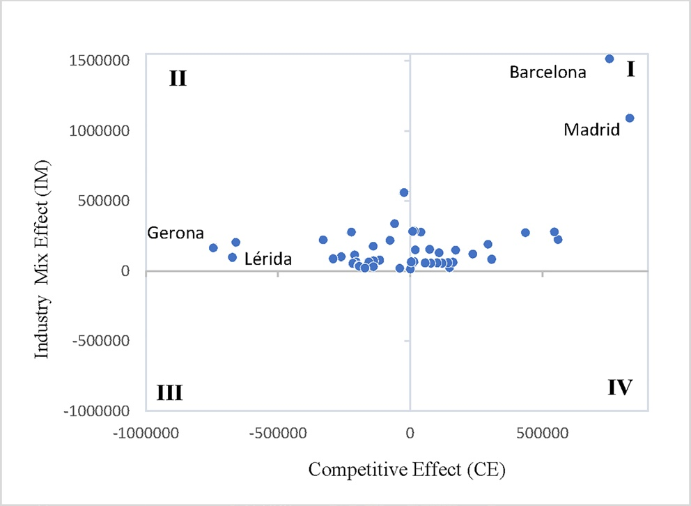

## What defines a region?

Choose a boundary that fits the question.

- **Administrative region.** A district government collects taxes inside its jurisdiction.
- **Functional region.** A labor market can span several districts when people commute between them.
- **Shared characteristic.** A rice-growing belt can cross district lines because farms share similar growing conditions.

::: {.prompt}
A worker lives in River and works in Harbor. Where would you count the job? Where would you count the household’s earnings?
:::


## What initiates a region’s growth?

**Demand.** Harbor orders more rice. River’s mill can raise output this week by putting an idle machine and an extra shift to work.

**Supply.** A second milling machine and training let the mill produce more even after both shifts are full. Across River, output per worker can also rise as workers move into more productive industries.

::: {.prompt}
Suppose River ships more rice this year. What evidence would tell you whether the mill used spare capacity or expanded its capacity?
:::


## How can exports in one industry impact other industries in the region?

Harbor buys rice from River’s mill. Two kinds of spending spread the effect through River.

- **Supplier purchases.** The mill hires a local repair shop. The shop gains sales even though all its customers are in River.
- **Household spending.** Mill workers spend some of their extra wages at River’s grocery. Part of those sales becomes income for local workers and owners.

::: {.prompt}
If the grocery restocks from a supplier in Harbor, what happens to the share of each sale that returns as income in River?
:::


## Should the seafood processor take the order?

A processor in a fictional Mekong Delta district can sell **20,000 kg of frozen fish each week** at **100,000 VND per kg**. The buyer, a supermarket outside the district, will take only the full shipment.

- The regular shift can handle **14,000 kg**. The last **6,000 kg** need overtime and rented cold storage.
- A better freight connection cuts shipping from **14,000 to 10,000 VND per kg**.

::: {.prompt}
Would you sign the contract? What part of the buyer’s payment will district residents earn?
:::

[handout (PDF)](seafood-order.pdf){target="_blank"}


## Overview of regional measurement

Today we will introduce measures that describe a region and help us compare regions to each other and compare their growth to national trends.

1. Sector shares describe the region’s composition. 
2. Location quotients measure the degree to which an industry is concentrated in a region relative to a benchmark.
3. Shift-share analysis compares a region's growth to national trends.

Define these indicators then apply them to Cần Thơ.


## Sectoral composition {.center .concept data-background-color="#eaf2f3"}

Which industries account for the region’s employment and output?


## What does each sector contribute?

Choose a boundary and a measure. Administrative, commuting,...

Let $x_{ir}$ be industry $i$’s activity in region $r$. An activity measure can be output, value added, employment, payroll, or hours. 

$X_r=\sum_i x_{ir}$ is the regional total 

Define **sector share** as $s_{ir}=x_{ir}/X_r$.

Sector shares normalize by the regional total allowing comparison of the relative importance of each sector across regions.


## What can output tell a regional planner?

| Planning decision | How to use the evidence |
|:------------------|:------------------------|
| **Where should we expand shared infrastructure?** | Compare peak physical output that must pass through each facility with its usable capacity. Investigate recurring bottlenecks. |
| **Which inputs need a second supplier?** | Use gross output and the share sold to local buyers to identify major suppliers. |
| **Which downturn should we plan for first?** | Multiply each industry’s share of regional value added by the percentage it could lose. Compare the direct losses to the regional economy. |

::: {.prompt}
Industry A generates 30% of regional value added and could lose 5% of its value added. Industry B generates 10% and could lose 20%. If both disruptions are equally likely, which would you investigate first?
:::


## What can employment tell a workforce planner?

| Planning decision | How to use the evidence |
|:------------------|:------------------------|
| **Which employers should we visit first?** | Use workplace job counts and employers’ layoff notices to find sites with the most workers at risk. |
| **Where should job-search clinics open?** | Map affected workers by residence. Choose sites they can reach by transit. |
| **When should outreach begin?** | If hours per job fall below seasonal norms, contact employers before layoffs begin. |
| **How much wage support should we budget?** | Estimate lost pay from payroll and cuts in paid hours. Apply benefit rates and eligibility rules. |


## Relative specialization {.center .concept data-background-color="#eaf2f3"}

Which industries are unusually concentrated relative to a benchmark?


## Location quotient

The location quotient (LQ) measures the degree to which an industry is concentrated in a region relative to a benchmark.

The benchmark is often a larger region, such as a province or the nation.

## Deriving the location quotient

Choose a measure $x$ such as jobs or value added. 

Let $x_{ir}$ be industry $i$’s amount in region $r$, 

$X_r$ the regional total

$s_{ir}=x_{ir}/X_r$ its share. 

Use $s_{ib}$ for the same share in benchmark $b$.

At the benchmark mix, industry $i$ would account for $X_r s_{ib}$ locally.

::: {.fragment}
$$LQ_{ir|b}=\frac{x_{ir}}{X_r s_{ib}}=\frac{s_{ir}}{s_{ib}}.$$
:::

::: {.fragment}
A LQ of 1.5 means the region's industry share is **50% higher** than the benchmark.

:::


## What can a LQ tell a planner?

An employment LQ above one means the industry employs a larger share of the workforce locally than it does in the benchmark.

- **Workforce planning.** Pair the employment LQ with the headcount to decide which employers to ask about vacancies and training.
- **Production and trade.** Use the output LQ to see whether the industry also accounts for an unusually large share of production. To identify its markets and understand where its customers are.

A national benchmark compares the city with the country. 

A provincial benchmark asks how the city stands out among nearer locations.


## Employment specialization in the Mekong Delta

:::: {.columns}
::: {.column width="60%"}
```{=html}
<iframe data-src="assets/world-bank-vietnam-urbanization-overview.pdf#page=20&amp;view=Fit&amp;toolbar=0&amp;navpanes=0" data-external="1" title="World Bank Box O.2, employment location quotients by region in Vietnam, PDF page 20" style="display:block; width:100%; height:510px; border:0;"></iframe>
```

::: {.source}
World Bank (2020), Box O.2. [Open PDF at page 20](assets/world-bank-vietnam-urbanization-overview.pdf#page=20){target="_blank" rel="noopener"}
:::
:::

::: {.column width="40%"}
**Employment LQs, 2016**

| Mekong Delta industry | LQ |
|:----------------------|---:|
| Marine fishing | 11.15 |
| Rice wholesaling | 3.31 |

Rice wholesaling’s share of enterprise employment was **3.31 times** its share nationally.

::: {.prompt}
Which industry was more specialized? 
:::
:::
::::


## Changes in composition and growth {.center .concept data-background-color="#eaf2f3"}

How much local growth would we expect if industries followed national trends?


## Shift shares

**Shift-share** asks how much a region would have gained if each sector had followed the benchmark. 

Choose an additive measure and call the local industry’s starting amount $x_0$ and ending amount $x_1$.

| Apply to the same $x_0$                  | Implied change    |
| :--------------------------------------- | :---------------- |
| $g$ · overall benchmark growth           | $x_0 g$           |
| $g_i$ · benchmark growth in industry $i$ | $x_0 g_i$         |
| $g_{ir}$ · local growth in that industry | $x_0 g_{ir}=x_1-x_0$ |
|                                          |                   |

Calculate each rate as $g=(x_1-x_0)/x_0$ for its own series. 

Shift-share can be defined for employment, output, payroll, or hours.


## Shift-share decomposition

Let $g_{ir}$ be the growth rate of industry $i$ in region $r$. Its observed change is $x_1-x_0=x_0g_{ir}$ when $x_0>0$.

::: {.fragment}
**Benchmark growth** $N=x_0g$ applies the overall benchmark rate.
:::

::: {.fragment}
**Industry mix** $M=x_0(g_i-g)$ credits the starting amount with the industry’s growth above or below the overall benchmark.
:::

::: {.fragment}
**Regional shift** $S=x_0(g_{ir}-g_i)$ measures how much more or less the local industry gained than it would have at its benchmark growth rate.
:::

::: {.fragment}
The terms sum to $N+M+S=x_1-x_0$. Sum across industries for the regional change. A large regional shift gives a planner a reason to ask local employers what changed.
:::


## Industrial growth across Spain’s provinces

:::: {.columns}
::: {.column width="55%"}
```{=html}

```

::: {.source}
[Montanía et al., Fig. 1](https://doi.org/10.1111/grow.12693) · ARDECO (2022) · [GISCO](https://ec.europa.eu/eurostat/web/gisco/geodata/statistical-units/territorial-units-statistics) © EuroGeographics
:::
:::

::: {.column width="45%"}
- In 2019, nine of the 47 mainland provinces accounted for nearly 60% of Spain’s industrial value added.
- Which provinces kept pace with Spanish industry from 2015 to 2019?
- Where did industry also outgrow the rest of the provincial economy?

::: {.prompt}
At Spain’s industrial growth rate, how much would Valencia’s industry have gained?
:::
:::
::::


## What gain would the national benchmarks imply for Valencia?

Valencia’s industry generated **€9,968.3 million** of value added in 2015. Use that same starting value ($x_0$) for both calculations.

| Benchmark implied by the study | Cumulative growth, 2015–2019 |
|:---|---:|
| Spain, all industries ($g$) | 4.28% |
| Spain, industrial sector ($g_i$) | 9.89% |

::: {.prompt}
On the board, calculate $x_0 g$ and $x_0 g_i$. How much does the benchmark gain change when you switch to the industrial rate?
:::

::: {.source}
Starting value from [Spain’s INE, provincial accounts](https://www.ine.es/jaxi/Tabla.htm?tpx=67289). Rates reconstructed from [Montanía et al. (2024), Table 4](https://doi.org/10.1111/grow.12693).
:::


## Valencia’s industrial output grew more slowly than Spain’s

:::: {.columns}
::: {.column width="56%"}
```{=html}
<div style="position:relative;">
  
  <svg viewBox="0 0 992 726" aria-hidden="true" style="position:absolute; inset:0; width:100%; height:100%; pointer-events:none;">
    <circle cx="580" cy="276" r="15" fill="none" stroke="#994414" stroke-width="4"/>
    <path d="M 565 273 L 531 252 L 500 252" fill="none" stroke="#994414" stroke-width="3"/>
    <text x="494" y="257" text-anchor="end" font-family="Arial, sans-serif" font-size="31" font-weight="bold" fill="#82390f">Valencia</text>
  </svg>
</div>
```

::: {.source}
[Montanía et al. (2024), Figure 3 and Table 4](https://doi.org/10.1111/grow.12693). Valencia label added. Graph ticks show thousands of 2015 euros.
:::
:::

::: {.column width="44%"}
**Valencia, 2015–2019**  
Millions of euros at 2015 prices

| Industrial value added | Change |
|:------------------|----------:|
| National growth ($N$) | +427 |
| Industry mix ($M$) | +559 |
| Gain at the study’s industrial benchmark ($N+M$) | +986 |
| Actual gain in Valencia | +963 |

**Regional shift** $S = 963 - 986 = -23$.
:::
::::


## Recap

Sectoral composition describes the region’s industrial structure.

Location quotients describe a region’s industrial **concentration**.

Shift shares provide a useful decomposition of local growth. How much can be atttributed to the benchmark, the industry mix, and a regional shift?

## Cần Thơ’s transportation and storage sector

Suppose Cần Thơ is considering a logistics training program. How important is transportation and storage to local workers and production? Does recent growth warrant talking to employers?

Use **Cần Thơ on its 2022–23 boundary**, with **Vietnam** as the benchmark. The 2023 yearbooks report 2022 levels and preliminary 2023 figures.

[Open the class workbook in Excel](can-tho-sector-data.xlsx). Enter formulas on **Excel exercise**. The **Sector data** tab contains the published figures and sources.


## Employment in the Cần Thơ statistical yearbook

<div style="width: 78%; margin: 0 auto;">

<div style="border-top: 1px dashed #89979d; margin: 12px 0;" aria-label="Intervening industry rows omitted"></div>

</div>

::: {.source}
[Cần Thơ City Statistical Yearbook 2023, table 31, p. 89 (PDF)](https://thongkecantho.nso.gov.vn/storage/manager/niengiam_tk/SzJyDEu-aacc0480-ce59-41ec-92d8-3c94220e5886.pdf#page=89). Selected rows. Periods separate thousands.
:::


## Which series belong in each calculation?

| Question | Series in the workbook | Unit |
|:---|:---|:---|
| Employment share, LQ and growth | Employed people aged 15 and older | People |
| Output share and LQ in 2022 | Current-price industry value added | Billion VND at 2022 prices |
| Change in output and its composition, 2022–23 | Industry value added at constant prices in both years | Billion VND at 2010 prices |

The all-industry output total equals GDP (or city GRDP) less product taxes net of subsidies. Use that total as the denominator for industry shares.

::: {.source}
2023 statistical yearbooks for [Cần Thơ](https://thongkecantho.nso.gov.vn/nien-giam-thong-ke/3) (tables 31, 42, 44) and [Vietnam](https://www.nso.gov.vn/en/default/2024/07/statistical-yearbook-of-2023/) (tables 59, 87, 89).
:::


## Describe the city’s sector mix

Open the [Cần Thơ Excel workbook](can-tho-sector-data.xlsx). On **Excel exercise**, fill rows **6–12** for 2022. Column B measures employment and column C measures current-price value added.

1. On **Sector data**, find the city’s industry and all-industry values for each measure.
2. Divide each industry by the matching city total. 
3. Check that each column totals 100% in row 13. Compare the six named industries. The last row pools the remainder.

::: {.prompt}
Which industry leads on each measure? Which ranking would you use to describe workers’ exposure to a sector downturn?
:::


## Calculate the two location quotients

For **transportation and storage**, complete rows **17–19**. Keep employment in column B and current-price output in column C.

| Row | Enter a formula for… |
|:---|:---|
| 17 | The Cần Thơ sector share you calculated in row 10 |
| 18 | Vietnam’s sector total divided by its all-industry total |
| 19 | The city’s share divided by the national share |

::: {.prompt}
Does each LQ fall above or below one? Write a sentence about specialization that a workforce planner and a regional accountant could both defend.
:::


## Did the sector gain local share?

Rows **23–30** link to the 2022 and 2023 yearbook levels. Use them to complete rows **32–34** for employment and real output.

1. Divide the city’s sector level by the city total in each year.
2. Subtract the 2022 share from the 2023 share and multiply by 100. Report **percentage points**.
3. Explain how a sector could grow and still lose share in the city economy.

For output, use **2010 prices in both years**. This gives the sector’s weight in real production over time.


## Decompose employment and real output growth

Complete **both columns** on **Excel exercise**. Keep the growth rates unrounded.

| Rows | Calculation |
|:----|:----------------------------------|
| 38–40 | Calculate 2022–23 growth for Vietnam overall, the national sector, and the city sector. |
| 42–44 | Multiply each rate by the city sector’s 2022 level in row 23. |
| 46–48 | Record the first gain, the second minus the first, and the third minus the second. Label them national growth, industry mix, and regional shift. |
| 49 | Check that the three components sum to the observed change in each column. |

Report column B in **people** and column C in **billion VND at 2010 prices**.


## Would you pursue a logistics training program?

Prepare a short briefing for the city.

1. **Sector mix.** Where does transportation and storage fit among the city’s industries?
2. **Specialization.** What do your two 2022 LQs say about employment and output relative to Vietnam?
3. **Growth.** Compare the city and national sector growth **rates** for each measure. Use each regional shift to express the departure in its own units.

::: {.prompt}
What would you ask employers or workers before committing funds? Name an answer that would change your recommendation.
:::

Module 4 examines how wages, rents and commuting costs shape location choices.


## Optional practice · How far does a hiring boom reach?

Cần Thơ’s sector totals leave a question open. How far does its labor market extend? Commuting flows connect employers with the households that earn the wages. Use the fictional corridor to see how these ties can cross a district line.

Suppose a plant in A hires a worker away from a firm in B. She keeps living in B, earns a higher wage in A, and leaves her former employer in B with a vacancy to fill.

::: {.prompt}
The plant adds 100 jobs. Can A’s mayor conclude that 100 more residents of A are employed? What would you need to know?
:::
